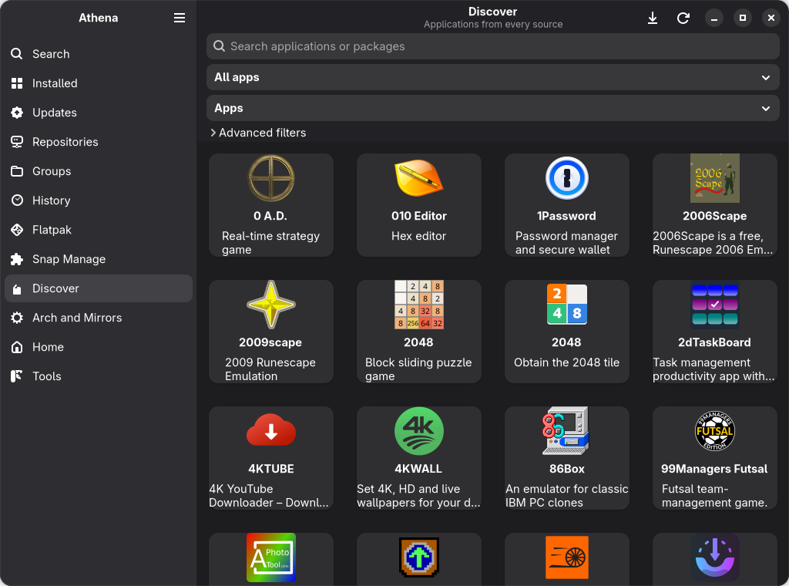
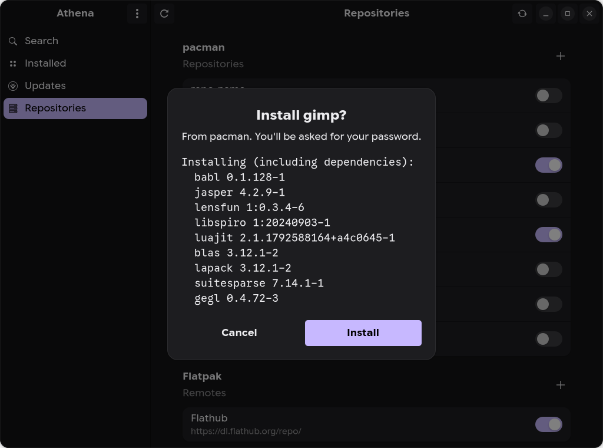
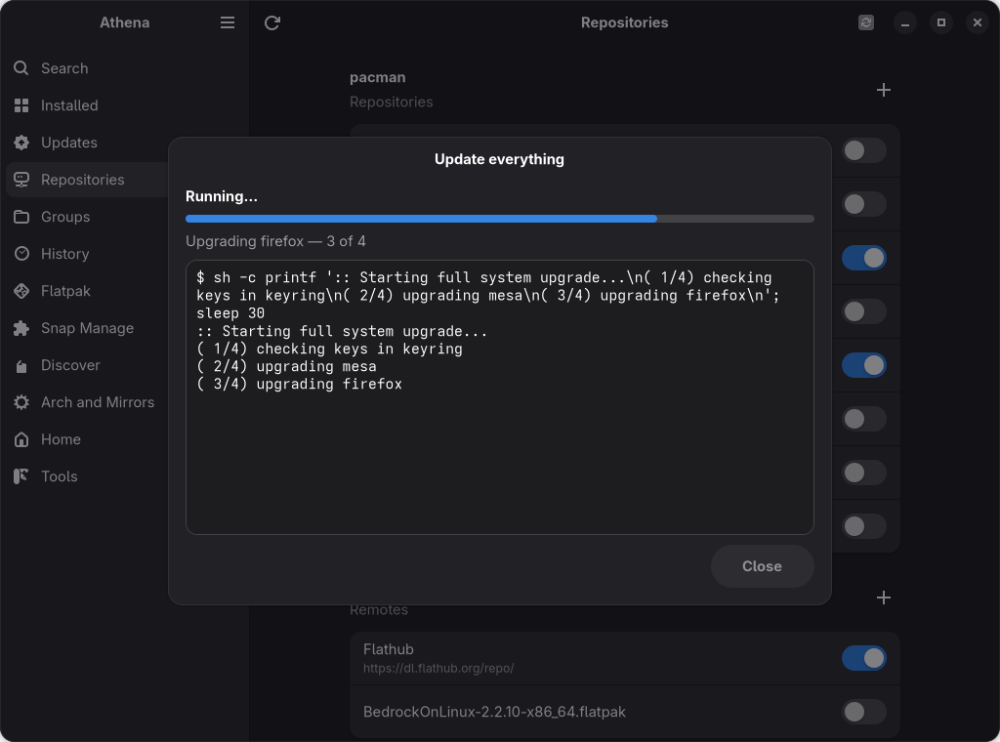
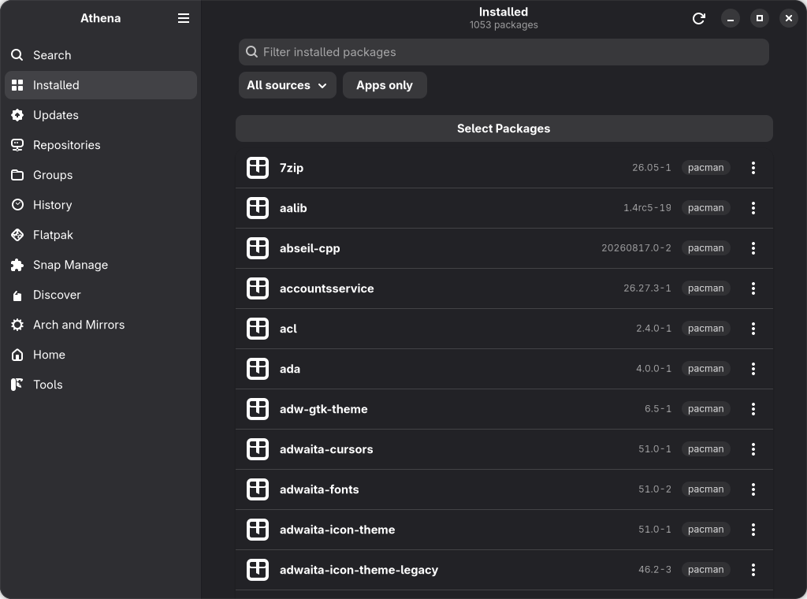
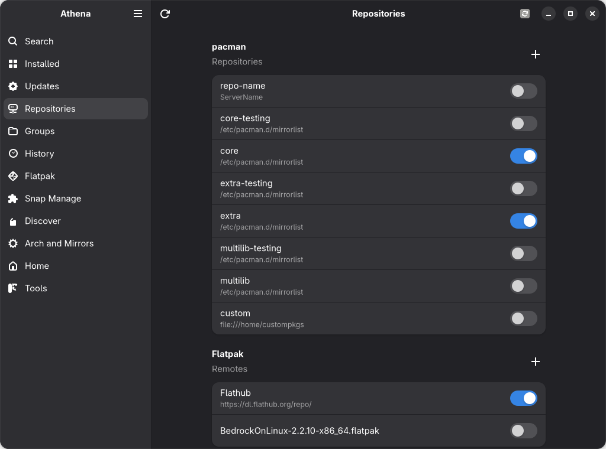
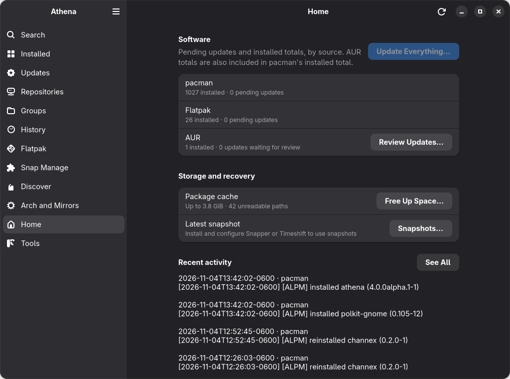
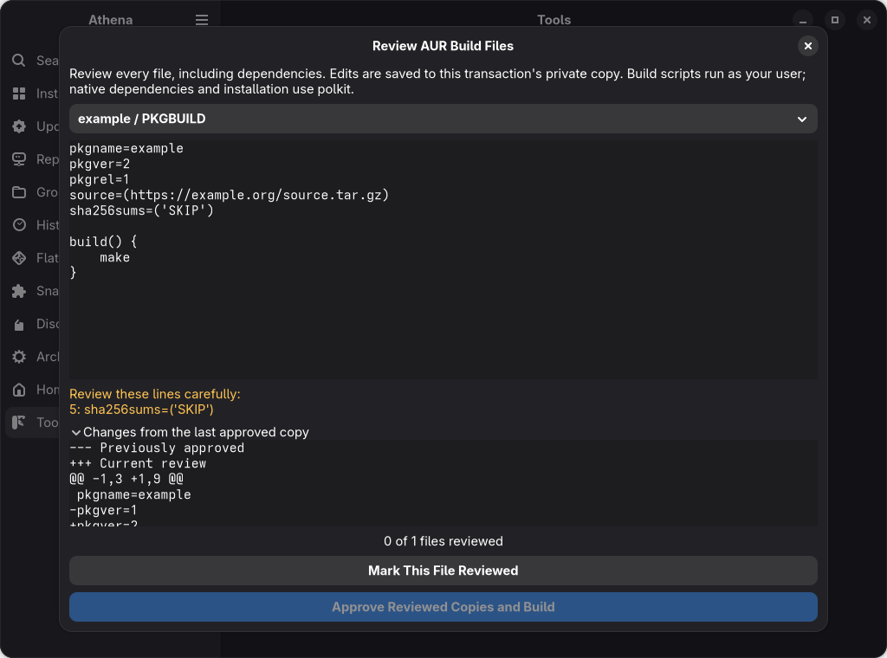
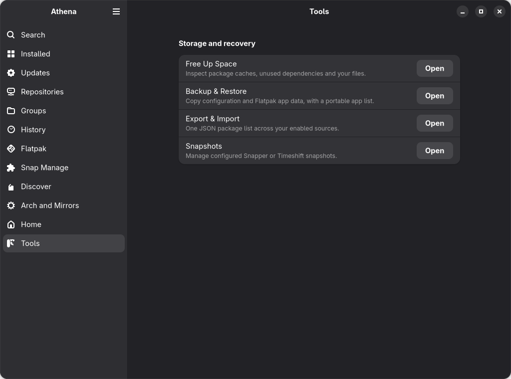
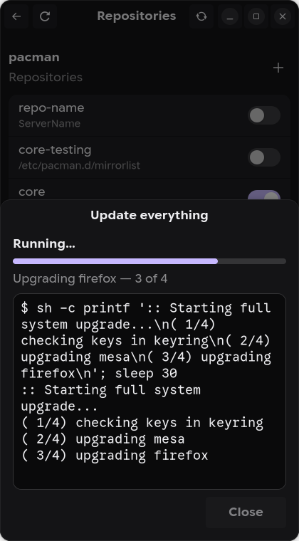

<div align="center">


# Athena

**One place for every package on your Linux system.**

Install, update, and remove software from your distribution's package manager (pacman, DNF, or APT), Flatpak, and Snap, in one GTK app.

[](LICENSE)
[](https://github.com/niruxx/Athena/actions/workflows/build.yml)



</div>

> [!NOTE]
> Athena 4 replaces the Qt version with **Rust, GTK 4 and libadwaita**. Version 4.0.0 is prepared locally; publication, AppImage validation on its Ubuntu build baseline, and Flathub review remain tracked in **[ROADMAP.md](ROADMAP.md)**. The Qt version remains in git history at `b169b76`.

## What it does today

- **Desktop integration:** optional periodic update checks with desktop notifications, a Background portal consent request, and an Update/Quit tray menu on compatible desktops. Checks run without installing packages; review opens Athena.
- **Localization:** gettext catalogs, a Spanish starter translation, and AppStream metadata for software centers.
- **Home and Tools:** source update counts, installed totals, cache sizes, recent activity, cleanup previews, configuration/Flatpak backups, portable package lists, and Snapper/Timeshift integration with optional snapshots before transactions. See [Tools and recovery](docs/tools-and-recovery.md).
- **Discover:** a virtualized application grid backed by native and Flatpak AppStream catalogs, with categories, merged source choices, package/dependency queries, and repository/architecture filters.
- **AUR on Arch:** RPC search, foreign-package updates, dependency planning, and mandatory build-file review before execution. Full updates open AUR review after other sources finish.
- **Arch tools:** unread news on Home, a news check before full updates, PKGBUILD viewing, helper management, and ranked mirror previews with backups. DNF has a fastestmirror setting.
- **Flatpak and Snap tools:** Flatpak permissions, app-data sizes/open/clear, and leftovers; Snap channels, revision revert, enable/disable, interface connections, and confinement information.
- **Search every source at once:** results arrive source by source, best name matches first, with a source filter.
- **Installed:** everything installed, with app names and icons from desktop files, an Apps only filter, and batch actions. Search, Installed, and Updates support selection and row context menus.
- **Updates:** pending updates grouped by source. Update one package, a whole source (its full update: `pacman -Syu`, `dnf upgrade`, `apt-get upgrade`, `flatpak update`, `snap refresh`), or everything at once.
- **Details:** package descriptions, versions, source choices, cached screenshots from available AppStream metadata, and desktop launching. Flatpak apps include a sandbox summary and permissions editor; pacman packages include cache and Arch Linux Archive version choices.
- **Groups and History:** search package groups, inspect installed members, install missing members, or remove installed ones. Browse raw source logs or a combined activity timeline.
- **Preferences and setup:** choose appearance, startup page, confirmation and terminal behavior, package row options, metadata expiry, and transaction logging. Manage Flatpak/Snap support and check for new Athena releases.
- **Downloads:** choose a folder and download selected packages with or without dependencies. Flatpak uses its own cache.
- **Repositories:** switch each repository or Flatpak remote on or off, add new ones (including COPR on Fedora), and update package lists.
- **See before you commit:** installs and removals show the resolved plan, with the dependencies pulled in or cleaned up, before anything runs.
- **Watch it happen:** every change runs in a window with a progress bar read from the package manager's own output, the current step, and the full log. Failures say why in plain words, including a dismissed password prompt or a missing polkit agent.
- **Fits any window:** the sidebar collapses to one pane in narrow windows, and the app follows your system's light/dark style and accent color.

<table>
<tr>
<td width="50%"></td>
<td width="50%"></td>
</tr>
<tr>
<td></td>
<td></td>
</tr>
<tr>
<td></td>
<td></td>
</tr>
<tr>
<td></td>
<td></td>
</tr>
</table>

## Supported systems

| Distribution family | Package manager | |
| --- | --- | --- |
| Arch Linux and derivatives | pacman | tested |
| Fedora / RHEL | dnf5 or dnf | implemented, parsers unit-tested |
| Debian / Ubuntu | APT | implemented, parsers unit-tested |
| Any of the above | Flatpak | tested |
| Any of the above | Snap | implemented, parsers unit-tested |

AUR builds on Arch use mandatory editable PKGBUILD review, including dependency build files and diffs against previous approvals. Athena builds exactly the approved local copy with makepkg; optional paru/yay helper management is also available. See [implementation notes](docs/catalog-and-aur.md).

## Building

You need Rust 1.92 or newer, GTK 4.14+, and libadwaita 1.5+.

```bash
# Arch
sudo pacman -S rust gtk4 libadwaita curl git
# Optional: native catalog, AUR builds, JPEG XL icons, mirror ranking
sudo pacman -S archlinux-appstream-data base-devel libjxl reflector
# Fedora
sudo dnf install cargo gtk4-devel libadwaita-devel curl
# Debian 13 / Ubuntu 24.04+
sudo apt install cargo libgtk-4-dev libadwaita-1-dev curl
```

```bash
git clone https://github.com/niruxx/Athena.git
cd Athena
cargo run --release
cargo test            # the backends' parsers
```

`cargo run -p athena-core --example probe` prints what each backend sees on your system (installed counts, updates, a test search, repositories) without changing anything.

### Packages

Each distribution's package is built in a container of that distribution, so it links against its own GTK:

```bash
packaging/arch/build-in-podman.sh     # dist-arch/athena-….pkg.tar.zst
packaging/debian/build-in-podman.sh   # dist-debian/athena_….deb
packaging/fedora/build-in-podman.sh   # dist-fedora/athena-….rpm
```

These need [podman](https://podman.io/). CI builds all three on every push.

## Privileges

Athena never asks for or stores your password. Changes to the system run through [`pkexec`](https://www.freedesktop.org/software/polkit/docs/latest/pkexec.1.html), so your desktop's own authentication dialog asks. Flatpak uses its own polkit integration the same way.

That dialog comes from a polkit authentication agent running in your session. Full desktops start one, but bare compositors (niri, Hyprland, sway) often don't. When none is running, Athena starts an installed one (polkit-gnome, polkit-kde, lxqt-policykit, and others). The packages depend on one so there's always an agent to start.

Searching, listing, and previews never need a password.

## Project layout

```
crates/athena-core   backends (pacman, DNF, APT, Flatpak, Snap), process running, polkit, parsers. No GTK
crates/athena        the GTK 4 / libadwaita app
data/                desktop entry and icons
packaging/           PKGBUILD, Debian and Fedora container builds, shared install script
```

## Changelog and license

See [CHANGELOG.md](CHANGELOG.md). Athena is licensed under the [GNU General Public License v3.0](LICENSE).

## Desktop and release notes

Enable background package checks in Preferences to request desktop permission.
The default interval is four hours; closing a window then keeps checks running.
Use Quit to end the process. Login startup is managed by the Background portal.
GNOME uses notifications; desktops with a StatusNotifierWatcher also get a tray menu.

See [release and packaging notes](docs/releasing.md), [translation instructions](po/README.md),
and the [Flathub readiness assessment](packaging/flatpak/README.md).
