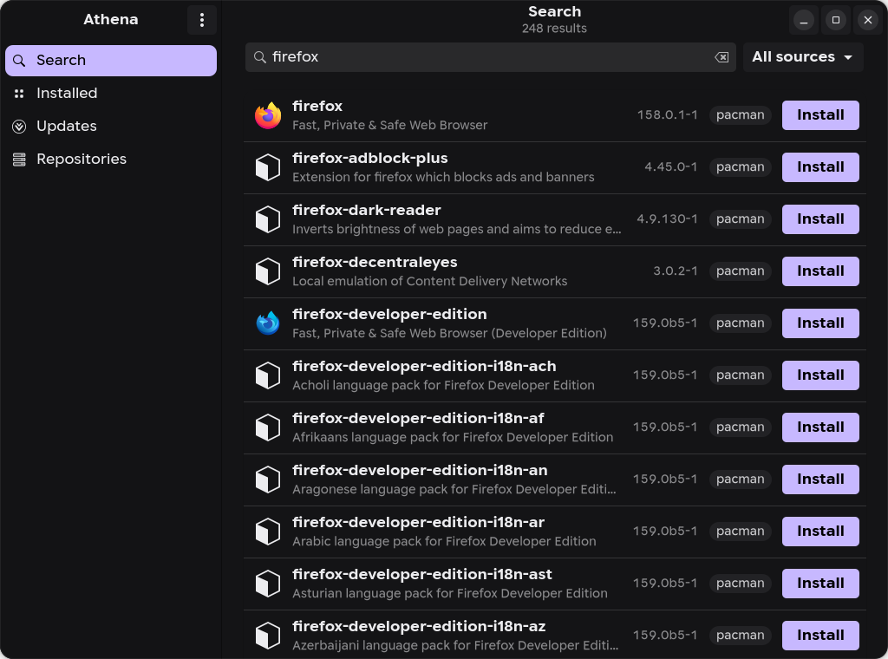

<div align="center">


# Athena

**One place for every package on your Linux system.**

Install, update, and remove software from your distribution's package manager (pacman, DNF, or APT), Flatpak, and Snap, in one GTK app.

[](LICENSE)
[](https://github.com/niruxx/Athena/actions/workflows/build.yml)



</div>

> [!NOTE]
> Athena 4 is a rewrite in **Rust with GTK 4 and libadwaita**, replacing the Qt version (3.0.0). It's in alpha: searching, installing, removing, updating, and managing repositories work today; the rest of 3.0's features are planned in **[ROADMAP.md](ROADMAP.md)**. The Qt version is in the git history at commit `b169b76`.

## What it does today

- **Search every source at once:** results arrive source by source, best name matches first, with a source filter.
- **Installed:** everything installed, from every source, filterable by name or source, with Reinstall and Remove.
- **Updates:** pending updates grouped by source. Update one package, a whole source (its full update: `pacman -Syu`, `dnf upgrade`, `apt-get upgrade`, `flatpak update`, `snap refresh`), or everything at once.
- **Repositories:** switch each repository or Flatpak remote on or off, add new ones (including COPR on Fedora), and update package lists.
- **See before you commit:** installs and removals show the resolved plan, with the dependencies pulled in or cleaned up, before anything runs.
- **Watch it happen:** every change runs in a window with a progress bar read from the package manager's own output, the current step, and the full log. Failures say why in plain words, including a dismissed password prompt or a missing polkit agent.
- **Fits any window:** the sidebar collapses to one pane in narrow windows, and the app follows your system's light/dark style and accent color.

<table>
<tr>
<td width="50%"></td>
<td width="50%"></td>
</tr>
<tr>
<td></td>
<td></td>
</tr>
</table>

## Supported systems

| Distribution family | Package manager | |
| --- | --- | --- |
| Arch Linux and derivatives | pacman | tested |
| Fedora / RHEL | dnf5 or dnf | implemented, parsers unit-tested |
| Debian / Ubuntu | APT | implemented, parsers unit-tested |
| Any of the above | Flatpak | tested |
| Any of the above | Snap | implemented, parsers unit-tested |

The AUR (with PKGBUILD review) comes back in phase 4 of the [roadmap](ROADMAP.md).

## Building

You need Rust 1.85 or newer, GTK 4.14+, and libadwaita 1.5+.

```bash
# Arch
sudo pacman -S rust gtk4 libadwaita
# Fedora
sudo dnf install cargo gtk4-devel libadwaita-devel
# Debian 13 / Ubuntu 24.04+
sudo apt install cargo libgtk-4-dev libadwaita-1-dev
```

```bash
git clone https://github.com/niruxx/Athena.git
cd Athena
cargo run --release
cargo test            # the backends' parsers
```

`cargo run -p athena-core --example probe` prints what each backend sees on your system (installed counts, updates, a test search, repositories) without changing anything.

### Packages

Each distribution's package is built in a container of that distribution, so it links against its own GTK:

```bash
packaging/arch/build-in-podman.sh     # dist-arch/athena-….pkg.tar.zst
packaging/debian/build-in-podman.sh   # dist-debian/athena_….deb
packaging/fedora/build-in-podman.sh   # dist-fedora/athena-….rpm
```

These need [podman](https://podman.io/). CI builds all three on every push.

## Privileges

Athena never asks for or stores your password. Changes to the system run through [`pkexec`](https://www.freedesktop.org/software/polkit/docs/latest/pkexec.1.html), so your desktop's own authentication dialog asks. Flatpak uses its own polkit integration the same way.

That dialog comes from a polkit authentication agent running in your session. Full desktops start one, but bare compositors (niri, Hyprland, sway) often don't. When none is running, Athena starts an installed one (polkit-gnome, polkit-kde, lxqt-policykit, and others). The packages depend on one so there's always an agent to start.

Searching, listing, and previews never need a password.

## Project layout

```
crates/athena-core   backends (pacman, DNF, APT, Flatpak, Snap), process running, polkit, parsers. No GTK
crates/athena        the GTK 4 / libadwaita app
data/                desktop entry and icons
packaging/           PKGBUILD, Debian and Fedora container builds, shared install script
```

## Changelog and license

See [CHANGELOG.md](CHANGELOG.md). Athena is licensed under the [GNU General Public License v3.0](LICENSE).
